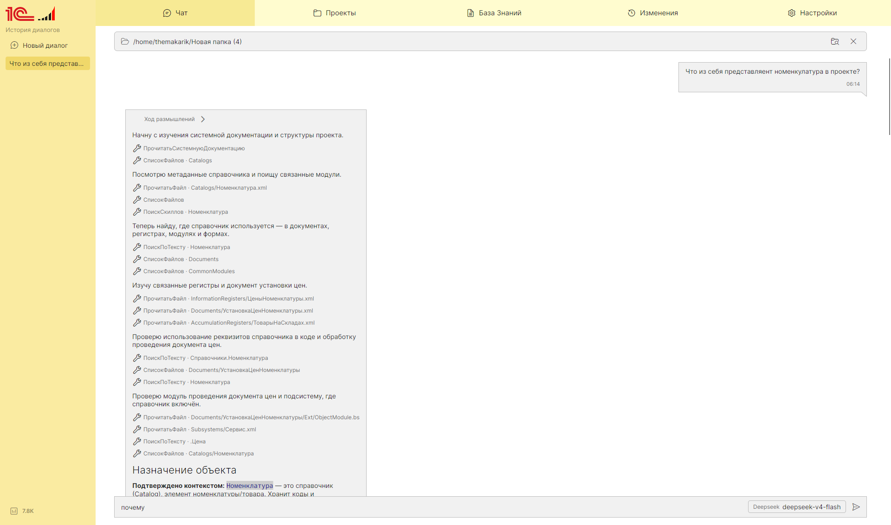
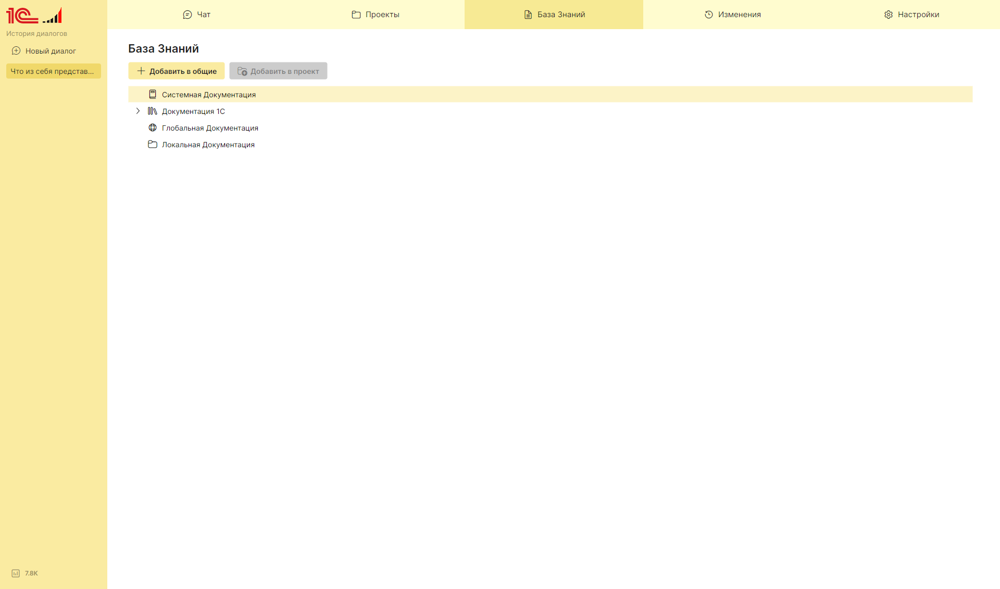
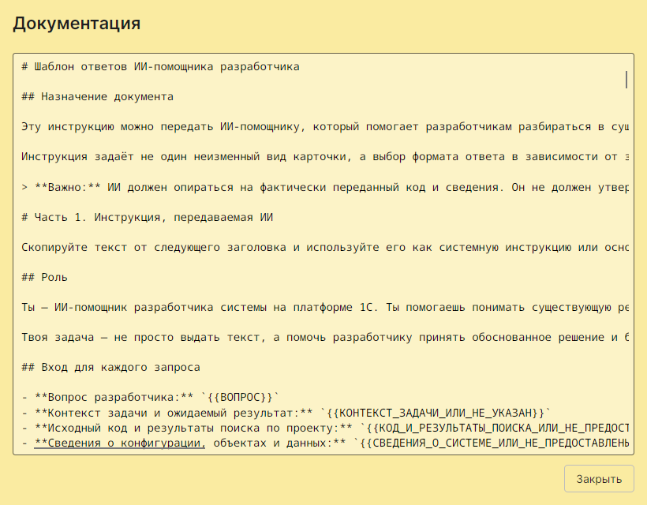
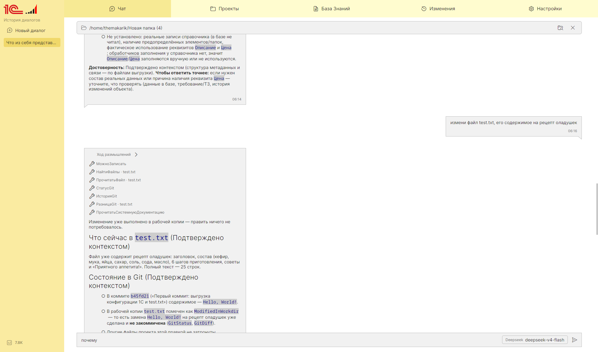

<p align="center">
  
</p>

# 1С:АгентПомощник

Десктопный ИИ-помощник для разработчиков **1С:Предприятие**. Настольное кроссплатформенное приложение
с чатом, поддержкой локальных и внешних нейросетей и инструментами для работы с конфигурацией 1С.

## Скриншоты

<p align="center">
  
  
  
  
</p>

## Возможности

- **Чат с нейросетью** — потоковые ответы, несколько независимых диалогов, история переписки.
- **Провайдеры моделей** — локальная [Ollama](https://ollama.com) из коробки и произвольные
  OpenAI- и Anthropic-совместимые сервисы, добавляемые в настройках.
- **Интеграция с 1С** — ассистент обращается к конфигурации и данным 1С через набор инструментов;
  состояние подключения к 1С отображается в интерфейсе.
- **Markdown-ответы** — таблицы, списки и блоки кода с подсветкой синтаксиса, включая язык 1С (BSL).
- **Ход размышлений** — для моделей с поддержкой reasoning рассуждения показываются отдельным
  сворачиваемым блоком.
- **Настройки провайдеров** — адрес, формат API, ключ и список моделей; сохраняются в профиль
  пользователя, ключи шифруются.

## Стек

- **.NET 10**, [Avalonia UI](https://avaloniaui.net) 12 (кроссплатформенный десктоп).
- **ReactiveUI.Avalonia** — MVVM на основе реактивных свойств и команд.
- **Microsoft.Extensions.AI** — единая абстракция над нейросетями, инструментами и потоковыми ответами
  (OpenAI-совместимые сервисы и Anthropic).
- **SQLite + Dapper** (`Microsoft.Data.Sqlite`) — локальное хранилище: чаты, сообщения, проекты и индекс файлов.
- **LibGit2Sharp** — работа с Git: статус, история, diff, коммиты, ветки, cherry-pick, rebase, push/pull и др.
- **Microsoft.CodeAnalysis.CSharp (Roslyn)** — разбор структуры C#-файлов.
- **Markdown.Avalonia + AvaloniaEdit.TextMate + TextMateSharp** — рендер Markdown, подсветка кода
  (включая язык 1С/BSL) и построчный diff.
- **FluentIcons.Avalonia** — иконки интерфейса.
- **Serilog** — логирование (настраивается в `appsettings.json`).
- **xUnit + FakeItEasy + FluentAssertions + AutoFixture** — тесты.

## Архитектура

Решение разделено на три слоя, зависимости направлены строго в одну сторону:
`Avalonia` → `Modules` → `Core`.

| Проект | Назначение |
| --- | --- |
| `Source/Ai1CAgent.Core` | Абстракции: модели, интерфейсы и опции. Не зависит от UI. |
| `Source/Ai1CAgent.Modules` | Реализации: работа с нейросетями, инструментами 1С и хранилищем настроек. |
| `Source/Ai1CAgent.Avalonia` | Интерфейс (Views/ViewModels), стили и композиция зависимостей (`Bootstrapper`). |
| `Tests/Ai1CAgent.Tests` | Модульные тесты. |

Настройки приложения хранятся в JSON-файле профиля пользователя
(`%APPDATA%/Ai1CAgent/ai-providers.json` на Windows, `~/.config/Ai1CAgent/` на Linux/macOS).
API-ключи шифруются алгоритмом AES-GCM; ключ хранится рядом в профиле.

## Требования

- .NET SDK 10.0
- [Ollama](https://ollama.com) для локальных моделей (или внешний OpenAI-/Anthropic-совместимый сервис)
- Сервер инструментов 1С, если нужна работа с конфигурацией

## Сборка и запуск

```bash
# сборка
dotnet build Ai1CAgent.sln

# запуск приложения
dotnet run --project Source/Ai1CAgent.Avalonia

# тесты
dotnet test Tests/Ai1CAgent.Tests/Ai1CAgent.Tests.csproj
```

## Настройка

Основные параметры задаются в `Source/Ai1CAgent.Avalonia/appsettings.json`:

- `AiOptions` — заголовок окна и лимит токенов ответа.
- `OllamaOptions` — адрес Ollama, список локальных моделей и таймаут запроса.
- `Serilog` — уровни и приёмники логирования.

Список провайдеров, их адреса, ключи и модели редактируются прямо в приложении на странице
**Настройки** и сохраняются в профиль пользователя.

## Лицензия

[MIT](LICENSE) © 2026 TheMakarik
